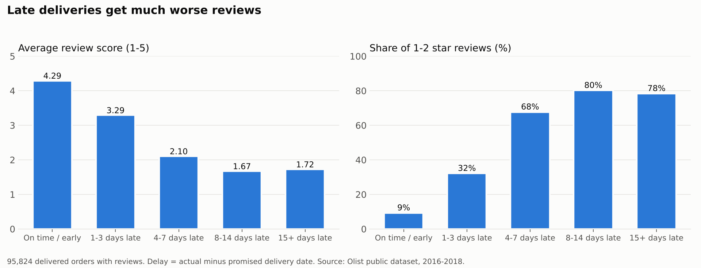
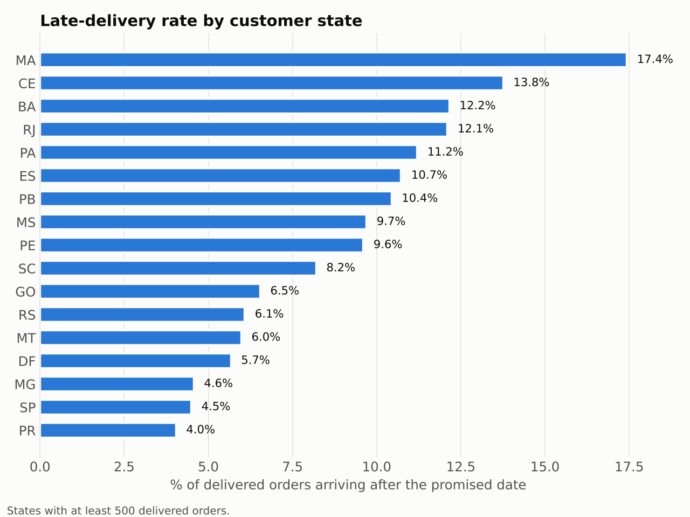

# Late Deliveries and Customer Satisfaction: A SQL Analysis of 100K E-commerce Orders

**Tools:** PostgreSQL 18 · SQL (CTEs, window functions, aggregate statistics) · DBeaver · Python/matplotlib (charts only)
**Data:** [Brazilian E-Commerce Public Dataset by Olist](https://www.kaggle.com/datasets/olistbr/brazilian-ecommerce): about 100K orders from 2016 to 2018, stored in 9 related tables

## Research questions

1. How strongly does late delivery relate to the review scores customers give?
2. Are customers whose **first** order arrived late less likely to buy again?
3. Where are delays concentrated, and which customer segments drive revenue?

## Key findings

- **Late delivery has a large association with review scores.** Orders that arrived on time averaged **4.29 / 5**. Late orders averaged **2.27 / 5**. Among orders more than a week late, about **80%** received 1–2 stars, compared with **9%** of on-time orders.
  - Welch's two-sample t-test: difference = 2.02 points, 95% CI [1.98, 2.06], t ≈ 101 (n = 89,443 on time vs 6,381 late).
  - **Robustness check:** the gap holds *within* every state that has 100 or more late orders (range 1.6–2.3 points), so differences between regions do not explain it.
- **A late first order goes with lower repeat purchase.** Customers whose first order was late came back **2.60%** of the time, compared with **3.06%** for customers whose first order was on time. That is a 15% relative drop (two-proportion z = 2.08, p ≈ 0.04). The effect is small in absolute terms, because repeat purchase on this platform is rare overall (about 3% of customers).
- **Delays are regional.** Late rates range from **4%** (PR, SP) to **17%** (MA). Northern and northeastern states have the longest delivery times and the lowest ratings.

- **Retention is the biggest business gap.** About 97% of customers buy only once. Monthly cohort retention stays below 1% in every month after the first purchase. RFM segmentation shows that "lost high-value" one-time buyers (15% of customers) account for **27%** of revenue. These customers are a clear win-back target.

> **Limitations.** This is observational data, so the results are associations, not causal effects. Late orders may differ in other ways too, such as product type, seller, or distance. Reviews are voluntary, so the customers who leave one may not be representative.

## Project structure

| File | What it does | SQL techniques |
|---|---|---|
| `01_create_tables.sql` | Schema for 9 tables with primary keys and data types | DDL, composite primary keys |
| `02_load_data.sql` | Bulk-loads the CSVs and checks row counts | `COPY`, `UNION ALL` |
| `03_data_quality.sql` | Missing values, duplicate keys, orphan checks; then adds foreign keys, indexes and a clean analysis view | `FILTER`, `NOT EXISTS`, `ALTER TABLE`, `DISTINCT ON`, views |
| `04_business_overview.sql` | Monthly revenue with month-over-month growth, top categories, delivery performance by state | `LAG`, `RANK`, `PERCENTILE_CONT`, `HAVING` |
| `05_delay_vs_reviews.sql` | Research question 1: delay buckets, Welch t-test, stratified check, correlation | `CASE`, `VAR_SAMP`, `CORR`, CTEs |
| `06_repeat_purchase_and_cohorts.sql` | Research question 2: repeat rate after a late first order, z-test, monthly cohort retention | `ROW_NUMBER`, `COUNT() OVER`, `AGE`, cohort pivot |
| `07_rfm_segmentation.sql` | RFM customer segments and their revenue share | `NTILE`, nested window aggregates |
| `results/` | Saved query output for every script | |

## Data quality notes (from `03_data_quality.sql`)

- `review_id` is **not unique**. 547 orders have more than one review, and some review IDs cover several orders. The analysis keeps the most recent review per order, and `(review_id, order_id)` becomes the primary key.
- 2,965 orders have no delivery date (shipped, canceled, and so on). Delivery analysis uses only the 96,470 orders that were delivered and have a delivery date.
- 610 products have no category, and 2 categories have no English translation. These are handled with `COALESCE`.
- The first and last months of the data are nearly empty, so trend analysis uses January 2017 to August 2018.
- No orphan rows were found, so all foreign keys were added after loading.

## How to reproduce

1. Install PostgreSQL and create a database: `CREATE DATABASE olist;`
2. Download the dataset from Kaggle and put the 9 CSV files in `/Users/Shared/olist_data/`, or edit the paths in `02_load_data.sql`.
3. Run the scripts in order, `01` through `07`.

The raw data is not included in this repository. It is licensed CC BY-NC-SA 4.0 by Olist.
